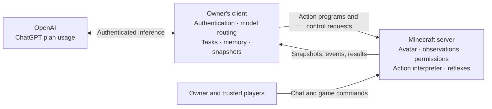

# Paracraft implementation plan

Status: agreed product direction and proposed implementation architecture; foundation implementation in progress. See [PROGRESS.md](PROGRESS.md) for verified coverage and remaining work.

Planning baseline: November 16, 2026. This document consolidates the initial concept and the owner's clarification pass. Defaults below are deliberate starting choices; items explicitly marked for prototyping are unresolved implementation details.

## 1. Product and scope

Paracraft lets a player summon AI companions into a Minecraft world. Each companion has a persistent identity, personality, memory, tasks, inventory, and a physical avatar. The server simulates the avatar and executes broad gameplay operations. The owner's client runs the AI harness and holds authentication credentials.

The first target is **Minecraft 1.20.1 with Forge**. Paracraft is required on the server and participating clients. Future Forge versions, Fabric, and NeoForge should fit behind platform adapters; implementing those ports is later work.

This is a personal-use, open-source project that others can compile for themselves. Marketplace publication and a hosted AI service are outside the initial distribution plan. Installation should require adding the mod and signing in. If a helper process becomes necessary, the mod installs or bundles what it needs, starts it, communicates with it, and shuts it down automatically. No separate app launch or manual pairing is required. Prefer Java unless another language materially improves a component.

Initial defaults:

| Setting | Default |
| --- | --- |
| Spawn access | Everyone |
| Avatars per owner | 4, configurable |
| Active avatars per server | 64, configurable |
| Decision cadence | At least 5 seconds between inference starts per avatar |
| Lightweight route | GPT Luna at the lowest supported reasoning effort |
| Planning route | GPT Luna with `xhigh` reasoning |
| Inventory search area | Avatar's current chunk plus its eight neighboring chunks |
| Ordinary command authority | Owner, plus explicitly trusted players |
| AI usage | Continue until paused, explicitly waiting, idle, or provider-limited |

Saved avatars do not consume active server slots. Reactivation after reconnect respects the configured active limit and reports any avatars awaiting capacity. Do not add inference quotas, spending budgets, or task lifetime limits in the initial implementation. Server processing budgets and configurable avatar limits exist to keep simulation responsive, independently of AI usage controls.

## 2. Architecture and responsibility



| Component | Responsibility |
| --- | --- |
| Client harness | Sign-in, provider calls, model selection, routing, context assembly, task and memory storage, cancellation |
| Server avatar | Authoritative physical state, survival, equipment, inventories, spawn point, dimensions |
| Server executor | Navigation, action programs, inventory transfers, mining, farming, combat, placement, command execution |
| Server observation service | Nearby world and container searches, job progress, event collection |
| Shared protocol | Versioned requests, observations, action definitions, results, and identifiers |
| Platform adapter | Loader/version-specific Minecraft objects, hooks, rendering, storage, commands, networking, chunk access |

Keep protocol records, task models, routing policy, and action-program definitions independent of Forge classes. Hide Minecraft types behind a small set of domain interfaces rather than attempting a universal abstraction for every game API. Implement and exercise the Forge 1.20.1 adapter first.

All physical world mutations run on the appropriate server thread. Network work and inference run asynchronously on the client. Navigation computation may use immutable captured data off-thread, with movement applied against live server state.

The server's command interface must also work with manually authored programs, allowing gameplay execution to be developed and tested independently of inference.

## 3. Avatar implementation and compatibility

**Preferred starting direction: a simulated server player with a persistent profile and no separate authenticated Minecraft client connection.** Full survival, equipment, player commands, beds, and mod interactions make a player-based actor the strongest initial candidate. Its presentation can use ordinary player synchronization, Paracraft packets, or a custom renderer because every client has the mod.

The actor owns a distinct UUID and profile. It never impersonates its owner for inventory ownership, operator privileges, or commands. Owning the inference session and being the actor executing an operation are separate concepts.

Prototype the exact `ServerPlayer`-based implementation against Forge 1.20.1 before settling its inheritance and lifecycle. Evaluate existing fake-player helpers as implementation material, not as an assumption that survival, ticking, menus, sleeping, dimension changes, and respawning already work. If that approach proves too fragile, evaluate a custom living entity with a player interaction adapter using the same public action protocol.

Rendering packets alone are insufficient to supply authoritative health, collisions, item ownership, or normal interaction behavior. The avatar must have a server-side actor regardless of its visual representation.

Implementation evidence: the Forge adapter now uses a survival-ticking simulated `ServerPlayer` registered in the native global roster, with a local in-memory transport for native hooks. This supplies native command identity and lifecycle integration. Those entries currently count toward Minecraft's online-player/max-players behavior; configure the native server limit accordingly. They are not separate authenticated Minecraft connections. See [COMMANDS.md](COMMANDS.md) and the cycle validation record in [PROGRESS.md](PROGRESS.md).

Compatibility goals:

- Use normal player interaction paths and Forge hooks where applicable, including protection/claim checks and mod cancellation events.
- Support modded armor, tools, weapons, food, and items through normal item behavior, attributes, and stack data. Preserve enchantments, NBT, and capabilities.
- Use generic inventory interfaces first, with adapters for special storage and interaction APIs.
- Expose a real actor identity to mods requiring a player; keep its persistent inventory and equipment as the single source of truth.
- Treat universal mod compatibility as a goal to expand through evidence, not a guarantee from inheriting one class. Custom menus, accessory slots, unusual combat mechanics, and mods requiring a genuine client connection may need integrations.

The avatar prototype must exercise damage, hunger, oxygen, modded equipment, block breaking, menus, commands, beds, death, respawn, chunk traversal, and dimension transfer. Choose the implementation on those results.

## 4. Authentication and runtime

Foundation implementation defers authentication and live inference until the owner can test sign-in as a follow-up. Build the provider boundary and account-status UI now, and exercise the same decision/action pipeline with an explicitly labeled deterministic simulator. No credentials or account linking are needed for foundation QA.

Build a custom snapshot harness with an inference-provider interface. The primary integration is official **Sign in with ChatGPT** with permission to use an eligible ChatGPT plan. The plan does not depend on reproducing undocumented Codex authentication or requiring the Codex desktop app.

OpenAI's current integration supports eligible local personal and open-source projects. Identity sign-in and permission to consume plan usage are separate. Eligibility and model access remain account-dependent; a completed inference establishes that a particular request worked. See the [official integration guide](https://developers.openai.com/cookbook/articles/sign-in-with-chatgpt).

The client manages browser sign-in, local callback handling, token refresh, sign-out, and protected credential storage. No authentication token, refresh token, or provider secret is sent in Minecraft packets or stored on the game server. Other connected clients receive no credentials. Show the connected account, selected model routes, pause state, and provider failures in the client UI.

Prefer a Java implementation. A mod-managed helper is acceptable if needed for authentication or a supported runtime. If used, communicate over private process pipes or an authenticated local channel and keep its lifecycle attached to the client. Installation and process management must remain automatic for the user.

Keep the inference surface limited to Paracraft observations and actions. Reading chat, signs, item names, or books does not grant permission to use the user's computer or add new tools.

The current HTTP ChatGPT plan-usage route requires `store: false`, `stream: true`, and explicit context in each request. Use its supported function/custom tool format and consume a response through its terminal completion event before applying returned mutations. Incomplete or failed streams do not execute partial action programs. These constraints belong in the provider adapter and may change over time. See [preview limitations](https://developers.openai.com/siwc/token-sharing-open-source/preview-limitations) and [models and inference](https://developers.openai.com/siwc/token-sharing-open-source/models-and-inference).

Attempt the real request and report actual provider errors. A cached model catalog or inferred account status must not become a speculative gate that prevents an otherwise valid inference. Refresh authentication or model selection in response to real failures without silently switching accounts or billing modes.

## 5. Model selection and escalation

Define two configurable routes named **Luna Light** and **Luna X High**. They initially use the same GPT Luna model with different reasoning settings. The owner can select the model and effort for each route without changing server logic.

Luna Light uses the lowest supported effort. Current official guidance lists `none` and `xhigh` among GPT-6 Luna's supported efforts, so `none` is the initial light-route candidate; `low` is an alternative when the selected model or route requires it. Verify through actual inference and make any necessary adjustment visible. Do not assume UI labels are API values or promise a fixed cost multiplier. [Reasoning-effort reference](https://developers.openai.com/api/docs/guides/deployment-checklist#set-up-reasoningeffort)

Each ordinary wake starts with Luna Light. Its permitted outcomes are:

| Outcome | Meaning |
| --- | --- |
| `chat` | Respond socially or report facts already present in the snapshot |
| `think_harder` | Ask the client to rerun the decision with Luna X High |
| No action | Keep the existing execution and task state unchanged |

Luna Light cannot issue gameplay actions, execute commands, mutate tasks or durable memory, alter permissions, change reflex settings, or perform additional world searches. The client enforces this tool surface. Any request requiring those operations must escalate.

On escalation, Luna X High receives the complete request, triggering event, tasks, memory, history, and world snapshot. Preserve the original request rather than substituting a router summary. Include newer observations/events with their timestamps if the world changed while routing. The light response can supply a short escalation reason but is not the authority for what the player requested.

Luna X High can query observations, manage tasks/memory, submit action programs, configure behavior, reply, and request a wait. Observation tools may require a continuation to use their results. Such continuations remain part of the current planning cycle and carry explicit tool results. A later decision cycle starts again with Luna Light and a newly assembled snapshot.

Examples:

- “Hey Josh, how's it going?” -> Light replies through `chat`.
- “Josh, find all the diamonds in our base and give them to me.” -> Light escalates; X High searches or submits a broad collection operation and establishes a task.
- “Josh, how far along are you?” -> Light replies from the inventory and job-progress snapshot when sufficient; otherwise it escalates for a fresh search.
- A running job is making expected progress -> Light may take no action while server execution continues.
- A job fails or a task needs resuming -> Light escalates so X High can decide the next operation.

## 6. Scheduling, wake events, and sleeping

Maintain one inference pipeline per avatar. Never run Light and X High simultaneously for the same avatar and never accumulate a backlog of obsolete snapshots.

The minimum interval is **five seconds between inference starts**, measured with a monotonic client clock. A new request begins no earlier than both the prior request's completion and five seconds after its start. This applies to Light-to-X-High escalation and observation-tool continuations too. It preserves the original “no faster than five seconds” rule while allowing back-to-back requests when inference already took longer.

For example, a Light call that finishes in one second can escalate at second five. One that finishes at second eight can escalate immediately then. Waiting for the cadence does not stop server simulation or existing jobs.

Wake conditions include:

- Initial avatar creation and restoration of unfinished work after reconnect.
- A mention of the avatar's name by the owner or an authorized player, or an explicit directed command.
- Damage, item pickup, death/respawn, and other meaningful survival events.
- Relevant job completion, unhandled failure, or loss of a target.
- A requested event or timer occurring.
- Ordinary continued work while unfinished tasks remain eligible to run.

Use the actual sender UUID and authorization state, not a displayed name, to determine whether chat can instruct the avatar. Name matching should be case-insensitive and avoid accidental substring matches such as matching “Josh” inside a longer unrelated name. Ambient chat can be observation data without becoming an instruction or wake trigger.

Coalesce repeated events while preserving counts and meaningful details. Item pickups from a collection job should be visible without launching overlapping inference. Events received during inference enter a pending queue for the next eligible snapshot.

Task-aware scheduling:

| Situation | Behavior |
| --- | --- |
| Unfinished queued, active, or inactive task | Continue decision cycles |
| Existing server job making progress | Job continues; snapshot reports its state |
| Explicit wait for time/event | Suspend periodic inference until the condition or an interrupting wake |
| No unfinished tasks and no new events | No inference |
| Idle patrol/routine | Server runs it without periodic inference |
| Owner pause, disconnect, or provider limit | Suspend inference; expose the reason |

An inactive task remains unfinished and keeps the companion eligible for decisions. This allows an avatar to pause diamond collection to teleport to its owner, then later reactivate collection. Explicit sleeping is the way to avoid polling when an unfinished task is waiting for something external.

Register event waits with an event cursor so an event arriving during registration is not missed. Waits may specify a timeout. Chat, damage, and other designated wake events can interrupt a wait. Tasks and wait definitions survive reconnect; expired timers are evaluated when the owner returns. Inference remains off while the owner is disconnected.

Provider errors do not erase tasks or repeatedly retry at full cadence. Use the actual error and retry timing, retain context, and show a recoverable paused state when a limit or sign-in problem requires it. Proposed default: pause gameplay work at a safe operation boundary when inference becomes unavailable, retaining server survival reflexes while the owner remains connected.

## 7. Snapshots and perception

Each decision is reconstructed from explicit state. It does not rely on a previous cycle's hidden context or a continuously growing provider conversation.

A logical snapshot contains:

- Avatar/profile ID, control-session ID, snapshot revision, world/dimension identity, timestamps, position, orientation, and movement state.
- Health, hunger, oxygen, effects, experience, spawn point, equipment, durability, and inventory.
- Nearby entities, blocks of interest, inventory summaries, known landmarks, and available interactions.
- Running programs, action IDs, current step, progress, results, failures, and resumable checkpoints.
- Tasks, personality, durable memory, and relevant recent conversation/command history.
- Triggering events with authenticated sender identity where applicable.
- Available tools and server-provided capabilities, plus the avatar's behavior settings.

Keep a complete logical client view while allowing packet deltas and targeted observations to reduce bandwidth. Request a fresh baseline if revisions are missing. The model receives enough current information to make the decision, with detailed block/item data available through broad queries. Avoid dumping every block or repeatedly listing unchanged inventories in full.

Perception is deliberately server-assisted. Line of sight and camera direction do not prevent discovery of nearby containers or authorized inspection of their contents. Paracraft must implement this synchronization: Forge capability contents are not sent to clients automatically. See [Forge capability synchronization](https://docs.minecraftforge.net/en/1.20.1/datastorage/capabilities/#synchronizing-data-with-clients).

Container search defaults to the **3-by-3 chunk square centered on the avatar**, including diagonals and relevant vertical levels in those chunks. It is not centered on the owner. A search beyond that neighborhood requires moving and searching again or an explicitly configured wider scope. Travel itself may cover much greater distances.

A search freezes its center and records its covered chunks. If some chunks cannot currently be inspected, report incomplete coverage instead of claiming zero matches. Chunk handling may load the immediate neighborhood incrementally; a search must not force-load the entire world. Movement and exploration may independently load and generate terrain.

Search results include locations, dimension, item match, observed count, known extractability, observation time, total count, and coverage/completeness. Remembered observations remain labeled as remembered rather than current. A total from nine chunks is never described as a whole-world or whole-base total unless that scope actually covers the base.

## 8. Container and item operations

Expose broad tools such as `search_containers`, `collect_items`, `deposit_items`, and `deliver_items`, as well as lower-level open/take/insert operations for composing programs.

`search_containers` accepts item IDs, tags, or a resolved item selector and returns all matches in scope in one result. Human terms such as “diamond” should resolve to clear item identities; do not silently count every item with a similar display name. Keep relevant stack distinctions when matching modded items.

`collect_items` performs a complete server job: inspect the requested neighborhood or explicit container list, choose a route, walk to each source, access it, extract matching items, and update progress. Its quantity may be a number or all matching items observed in the selected scope. Freeze that scope at job start so moving between containers does not silently expand a finite collection task forever.

The agent can intentionally search again after moving or repeat collection to implement an ongoing task. It does not need to call open/inspect on every individual chest.

Transfers happen at reachable interaction positions, using the avatar's actual inventory capacity and the source/destination's real insertion/extraction behavior. Broad awareness does not imply remote item teleportation. `open_inventory(position)` includes navigation and returns a server-managed interaction reference. Moving away, changing dimensions, or replacing the target invalidates the interaction as appropriate.

Forge 1.20.1 integration should use `ForgeCapabilities.ITEM_HANDLER` / `IItemHandler` where supplied and vanilla `Container` / `WorldlyContainer` interfaces where appropriate. Respect sided access and slot rules. Capability presence must be established by querying the actual object, not guessed from a block name or a list of installed mods. [Forge inventory capabilities](https://docs.minecraftforge.net/en/1.20.1/datastorage/capabilities/)

Not every visible storage UI exposes a universal item inventory. Custom network terminals, virtual storage, menu-only systems, and unusual access rules may need adapters. Search and transfer support must state their actual coverage. A container may be observable but refuse extraction; report that actual result. Do not bypass a machine's restrictions by modifying its backing storage directly.

Normalize duplicate views of the same inventory where identity is available, including double chests and sided wrappers. Network-storage adapters must identify shared backing storage or report uncertain aggregate counts rather than counting the same items repeatedly through several terminals.

Re-read relevant stacks at execution time and use actual transfer results. Inventories may change while the avatar walks. Account for every moved stack and insertion remainder without loss or duplication; report shortfalls and partial completion. Preserve the distinction between items acquired for this job and matching items the avatar already carried.

Progress should include requested amount, acquired amount, delivered amount, visited/remaining sources, last-known remaining matches, current destination, and any shortfall. Mark stale estimates. A simple progress question can then be answered from the next snapshot without searching every inventory again.

## 9. Action programs and interpreter

Represent programs as structured command objects serialized through a versioned schema. The AI selects domain operations; the server interprets them as asynchronous jobs. This is not arbitrary Java, JavaScript, shell, or downloaded code execution.

Support ordered sequences, named intermediate results, action arguments, explicit pause/resume/cancel, and nested `try`/`catch`. Programs can pass a search result to a collection action or a collected-item result to delivery without another model decision between each step.

Illustrative syntax, not a finalized wire format:

```json
{
  "taskId": "retrieve-diamonds",
  "mode": "replace",
  "steps": [
    {
      "try": [
        {
          "op": "collect_items",
          "item": "minecraft:diamond",
          "quantity": "all",
          "scope": { "kind": "neighbor_chunks", "radius": 1 },
          "saveAs": "collected"
        },
        {
          "op": "deliver_items",
          "itemsFrom": "collected",
          "recipient": { "playerUuid": "<requester-uuid>" },
          "delivery": "drop_at_feet"
        }
      ],
      "catch": [
        { "op": "report_failure", "errorFrom": "caught" }
      ]
    },
    { "op": "report_result" }
  ]
}
```

Semantics:

- Steps execute in order. A long-running step completes, fails, or is interrupted before its dependent next step executes.
- An unhandled failure stops the remaining program, preserves accomplished work, and wakes the decision pipeline with the error and actual state.
- A `try` body may contain multiple steps and nested `try` blocks. Failure jumps to the nearest applicable `catch` and skips the rest of that failed body.
- When a catch succeeds, execution resumes after that try/catch construct. Failure inside a catch propagates outward. An explicit rethrow can preserve failure when recovery was incomplete.
- Catch context includes the failed operation, structured error, partial results, and current relevant state. Already completed transfers, movement, placement, or mining are not rolled back.
- Cancellation, owner disconnect, avatar death, and revoked authority are control events, not ordinary recoverable action errors. A catch cannot override them and continue operating.
- Every program, action, and request has stable IDs. Retried submissions return the existing result/job rather than performing the same operation twice.
- Submission modes explicitly distinguish append, replace, and resume. A new snapshot alone never replaces a running job.
- Interrupt at the next safe mutation boundary, normally immediately for movement and after an indivisible transfer or world mutation. Never leave half an item transfer applied.
- Persist program position, completed-step results, and interrupted status. After a server restart, reconcile with the world before resuming; do not blindly replay side effects or claim universal atomicity across third-party storage systems.

Validate syntax, ownership, and operation types directly. Evaluate dynamic world conditions at execution time; do not reject an entire program because a guessed future state suggests a later step might fail. Programs have finite submitted structure and use an incremental interpreter so even immediate steps cannot stall a server tick. Long-lived activities use resumable jobs or repeated tasks.

Future composites can express “collect ingredients, craft a quantity, deposit the products” through the same interpreter. Generic crafting and smelting adapters are expansion work, not prerequisites for initial collection and delivery.

## 10. Tasks, memory, and personality

Tasks describe intentions; programs describe physical execution. A task contains an ID, goal, priority/order, status, progress notes, and references to any running or interrupted programs.

| Task state | Meaning |
| --- | --- |
| Queued | Unfinished work awaiting attention |
| Active | Current intention being pursued |
| Inactive | Unfinished work deliberately set aside and eligible for later resumption |
| Waiting | Work waiting for an explicit event/time condition |
| Completed | Agent considers the goal fulfilled |
| Failed | Agent considers the goal failed or unachievable, with a reason |

Luna X High controls task creation, ordering, activation, suspension, and terminal status. The server reports action facts; a successful program does not automatically complete its parent task. An indefinitely recurring task can remain unfinished for as long as requested.

A player instruction does not automatically dictate a scheduling policy. It wakes the agent, which decides which task to deactivate and which to pursue. Direct owner stop/pause/destroy commands remain immediate control operations.

Example: Josh is gathering diamonds. The owner requests an immediate teleport. Josh pauses the gathering program, records its progress, marks that task inactive, and handles the teleport request. The gathering task remains on the list and keeps ordinary decision cycles eligible after the immediate request is handled. Josh later reactivates it using the actual remaining work.

Use three context stores:

1. **Personality and durable memory:** owner preferences, behavioral instructions, facts deliberately saved by the agent, and summaries.
2. **Tasks:** intentions, priority, progress, and resumption information.
3. **Rolling history:** recent authorized chat, emitted replies, submitted programs, important events, and action results.

A companion profile can carry personality and general memories across servers. Physical inventory, spawn point, tasks involving world objects, homes, permissions, and observed locations are namespaced by server/world/avatar binding. Never transfer inventory or treat one server's coordinates as another's. Address-based server identity alone should not merge different worlds after a reset.

The owner can define personality through ordinary conversation; X High writes the resulting personality memory. Stable owner instructions and ongoing tasks must survive memory compaction. Compact older history and redundant memories when necessary, retain provenance and relevant identifiers, and make explicit that the next decision uses the compacted record. Avoid an unbounded prompt or automatic loss of active commitments.

The client persists cognitive state locally. The server persists the physical avatar and program checkpoints. On reconnect, reconcile both using persistent IDs and revisions. If the client has lost its local memory, report that condition and reconstruct known physical/job state rather than inventing prior intentions.

Associate accepted programs with persistent task IDs and record acknowledgments so an interrupted client update cannot orphan a running job or resubmit completed work. When a snapshot changes during inference, reconcile the proposed result with the current control session and job state. Ordinary movement alone should not invalidate an otherwise applicable plan; current execution conditions determine whether its actions succeed.

## 11. Gameplay execution and reflexes

Server logic handles frequent, mechanical behavior without inference. The agent observes results and supplies goals and configuration.

### Navigation and terrain

Support walking, following entities, swimming, climbing where supported, opening doors, breaking obstructions, placing bridges, and pillaring with available materials. Respect normal tools, placement, inventory consumption, reach, and world interaction rules.

Use a route planner plus local movement/recovery. Long routes must work across chunk boundaries with incremental chunk loading/generation and progress reporting. Keep chunk tickets around the actor and necessary route segment; release them as the route advances or the actor leaves. The owner need not remain nearby.

Automatic ordinary navigation must not choose to enter a portal. Dimension travel is an explicit operation selected by the agent, using a known portal or server-provided teleport command. Searching for portal blocks is a supported broad observation. If no route or teleport exists, the agent can ask an authorized player for help.

### Survival and respawn

Support normal health, hunger, oxygen, armor, durability, effects, experience, death, dropped inventory, and respawn behavior subject to server rules. Server reflexes eat suitable carried food when hungry and attempt to escape an oxygen hazard. Snapshots let the agent notice declining supplies and arrange replenishment.

Respawn points come from normal bed interactions. On initial creation, the companion should seek an available suitable bed and attempt to establish its spawn there. Brief sleeping is desired where the game permits it; distinguish successfully setting a valid spawn from successfully entering sleep. Report occupied beds, invalid dimensions, missing beds, or other actual failures. Use the server's normal fallback spawn behavior until a valid bed spawn exists.

The owner can request a new bed location. The agent can use an available bed, place one it carries, or ask for materials/help. Automated bed crafting depends on later crafting support. Broken or obstructed spawn beds follow normal game behavior and appear in the next snapshot.

### Combat and behavior configuration

Expose agent-editable behavior profiles with separate reactions to players and mobs: passive, flee, neutral/retaliate, and supported aggressive behavior. Sensible starting behavior is neutral toward hostile mobs, passive toward players, and retreat from player attacks where possible. Authorized instructions can change these settings.

The server performs targeting, movement, attack timing, and applicable equipment use. Damage still generates a wake event. Reflexes can temporarily interrupt a program and report why, without making the AI choose every attack or swim movement. Owner stop and explicit program cancellation take precedence over task execution; survival behavior has its own clearly reported state.

### Mining, farming, equipment, and placement

Mining supports a block, a block list, and a cuboid. The server approaches targets, chooses an effective carried tool that can harvest correctly, respects break time and durability, collects drops, and reports progress. An unrecovered mining problem stops the job and triggers a snapshot with the reason; an enclosing script catch may implement explicit recovery.

Provide initial farming, combat, equipment management, and block placement operations. Start with standard game behavior and extensible adapters rather than hardcoded vanilla item lists. Basic placement/build sequences should be possible initially; sophisticated construction planning, broad recipe execution, smelting workflows, and custom machine automation expand later.

Idle routines such as A-to-B-to-C patrols execute without inference and yield to actual work. Routine waypoint events do not wake the model. Meaningful damage, pickups, failures, and authorized chat still do.

## 12. Commands, delegation, and control sessions

The owner is the only instruction authority initially. The owner can add/remove trusted players through raw Paracraft commands or by asking the avatar to do so. A trusted player's mention can then wake and instruct that avatar, but inference still runs on the owner's client and uses the owner's account.

Maintain a persistent server-side authorization list keyed by UUID. Distinguish permission to give instructions from permission to change the list or destroy the avatar. Proposed default: trusted players receive instruction permission; ownership and permission administration stay with the owner unless explicitly delegated. An agent can apply an owner's natural-language delegation request through the same authoritative server operation.

The requesting network connection establishes control. Commands include avatar and control-session IDs, but the server verifies the actual connected owner rather than trusting those fields. Allow exactly one active inference controller per avatar. Revoked instructions cannot gain new authority merely because a model reply arrived late.

Expose an `execute_command` action for normal server commands, including `/home`, `/sethome`, `/tpa`, or `/tp` when installed and permitted. Execute as the avatar with its own permissions and player context, never as console or implicitly as the owner. Discover available command forms through the actual server command system where possible and return real output/errors.

Do not add a special owner command that freely teleports an avatar. Travel convenience comes from normal commands or portals. For a request to come to the owner, the agent can try `/tpa` if available, wait for acceptance, and observe completion. Acceptance of a teleport request command is not proof that the avatar has teleported. Homes and command-managed state belong to the avatar's identity and server.

Raw Paracraft controls should cover spawn, list/status, pause/resume, destroy, and trusted-player management. Exact command spelling and UI layout are implementation details. Model routing, authentication, task status, and reflex settings should also be inspectable from the client.

## 13. Persistence, disconnects, and destruction

On owner disconnect:

1. Cancel local inference and invalidate its result for gameplay submission.
2. Revoke the server control session and stop the program at a safe operation boundary.
3. Close live interactions and save the avatar, inventory/equipment, survival state, location/dimension, bed spawn, identity, configuration, authorization list, and job checkpoints.
4. Remove the avatar from the world and release its chunk tickets.

The server handles connection loss independently so client crashes cannot leave avatars running indefinitely. A local helper or harness failure while Minecraft stays connected also needs a control-session loss path.

When the owner reconnects, restore the avatar at its saved location and dimension, subject to normal world validity and configured active capacity. Reconnecting does not move it to the owner's new location. Reconcile job/task state and let the agent resume deliberately; do not repeat completed transfers. Trusted players cannot keep it online while the owner is absent.

An explicit destroy command permanently removes that server avatar and drops all carried/equipped items exactly once at its saved/current world location. Handle destruction of an offline saved avatar as well. Make the local companion profile's future use separate from deletion of its physical server instance; deletion must not leave runnable programs bound to a nonexistent actor.

Death is distinct from disconnect and destruction. Apply the server's death/drop rules, preserve identity and appropriate cognitive state, and respawn according to the normal spawn system. Surface inventory loss and interrupted tasks to the agent. Persistence must not resurrect a second copy of dropped items.

## 14. End-to-end diamond retrieval example

1. The owner says, “Josh, find all the diamonds here and give them to me.” The server verifies the speaker and emits a mention event to Josh's controlling client.
2. Luna Light receives the snapshot and calls `think_harder`.
3. At the next allowed inference start, Luna X High receives the full request and context, creates a task, and either searches containers first or directly submits `collect_items` for diamonds in the current nine-chunk neighborhood.
4. The server reports the scope and observed matches, then walks Josh between source containers and collects diamonds into his own inventory.
5. While the job runs, the owner asks for progress. The next snapshot includes acquired diamonds, visited sources, remaining sources, and any uncertainty. Light can answer directly or escalate for a fresh query.
6. The server completes collection and reports actual results. A programmed delivery step can then walk to the requester and drop the acquired diamonds at their feet. If teleport assistance is needed, the agent can instead arrange an authorized server command and resume delivery afterward.
7. The next planning decision checks the delivery result, replies with the actual outcome, and marks the task complete or explains any shortfall. Dropping at a player's feet is observable delivery; it does not guarantee that player picked up the items.
8. With no unfinished work, Josh stops invoking the model and may run an idle routine.

“All diamonds in our base” only covers the inspected neighborhood initially. If the base extends beyond it, Josh must move and inspect more areas or report the scope it actually searched. World-wide inventory scanning is not implied.

## 15. Implementation sequence and validation

### Milestone 1: Forge foundation and avatar lifecycle

Create the Forge 1.20.1 project, shared domain/protocol boundary, and simulated-player prototype. Implement spawn, ownership, rendering, basic inventory/equipment, survival, destruction, save/despawn, and reconnect restoration. Confirm the actor approach using actual interactions before expanding the action library.

### Milestone 2: Deterministic execution and observations

Implement navigation, nine-chunk inventory discovery, generic container access, collection, delivery, task-linked program status, and basic interpreter sequencing. Add nested try/catch, interruption, request deduplication, and resumable checkpoints. Drive these from manually authored commands before introducing model variability.

First gameplay demonstration: collect diamonds from containers across the avatar's current chunk and immediate neighboring/diagonal chunks, then deliver them to a player.

### Milestone 3: Routed client harness and simulated inference

Add configurable Light/X-High routes, separate tool surfaces, explicit snapshots, rolling history, tasks, personality, memory, and the five-second scheduler. Exercise the diamond request through chat end to end with the labeled deterministic provider. Include a visibly disconnected account-status UI and an extension point for later sign-in. Actual authentication and live inference are a follow-up after the foundation works.

### Milestone 4: Interruptions, waits, delegation, and commands

Add trusted-player instructions, natural-language permission changes, pause/resume workflows, event/timer waits, server command execution, teleport acceptance handling, idle routines, and clean inference cancellation. Demonstrate an inactive task resuming after the owner requests a different action.

### Milestone 5: Broader gameplay and mod compatibility

Expand block/list/cuboid mining, farming, combat/reflex configuration, equipment management, basic placement, bed respawn, long navigation, chunk generation, and explicit portal/dimension travel. Validate representative modded inventories and tools; add custom integrations where actual API differences demand them.

### Later expansion

Add generic crafting/smelting composites, more advanced building, storage-network adapters, additional loaders/versions, richer client controls, and optional usage budgets. Keep the broad action interpreter and provider abstraction stable as these capabilities grow.

Behavioral acceptance checks:

- Light can chat but cannot perform gameplay or mutate tasks/settings without escalation.
- Escalation retains the original request; all inference starts obey cadence and never overlap per avatar.
- Chat progress replies do not restart collection or duplicate requests.
- Nested catches run in order, receive partial results, and continue correctly; cancellation escapes all catches.
- Inactive unfinished tasks keep scheduling; explicit waits suspend polling and wake reliably.
- Unauthorized senders cannot trigger instructions or seize a controller; trusted players use the owner's client without receiving credentials.
- Search covers exactly the declared nine chunks, reports missing coverage, and does not double-count known shared inventories.
- Transfers survive changing contents, full inventories, rejected slots, modded stack data, and interruption without item loss or duplication.
- Disconnect during inference, travel, mining, or transfer removes/saves the body; late outputs cannot act after reconnect.
- Reconnect restores the saved location and does not replay completed side effects; destruction drops inventory once.
- Eating, oxygen escape, configured retaliation, death, and respawn work without per-tick model calls.
- `/tpa` or other delayed commands are tracked to actual results; unavailable commands report real errors without granting elevated privileges.
- Server processing stays responsive with multiple avatars and incremental searches/routes; configured 4/64 defaults are exercised as capacity targets, not assumed performance guarantees.

This plan is the implementation reference. The exact simulated-player class, navigation engine, helper-process need, command names, schemas, and mod-specific adapters should be settled by the corresponding working prototypes, while preserving the behavior and ownership boundaries above.
